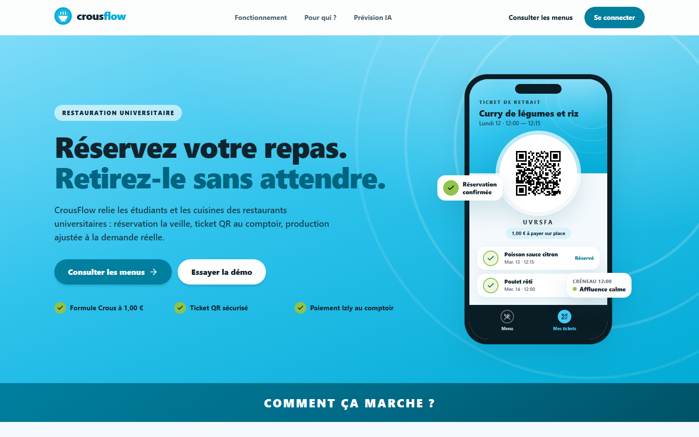
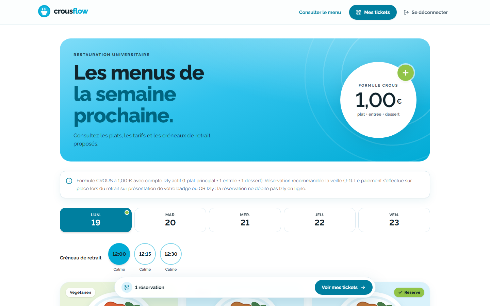
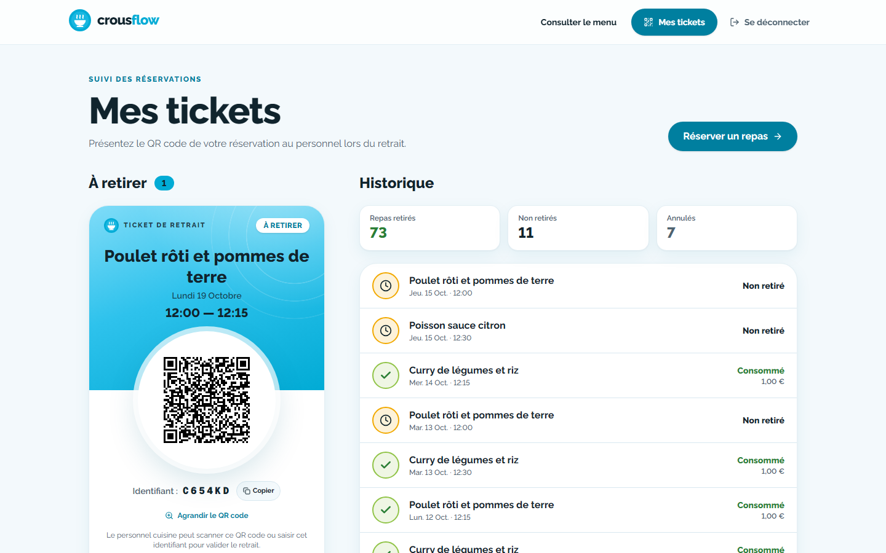
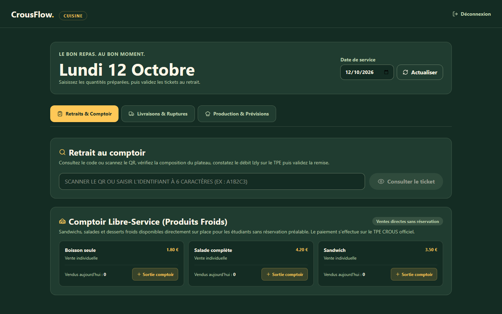
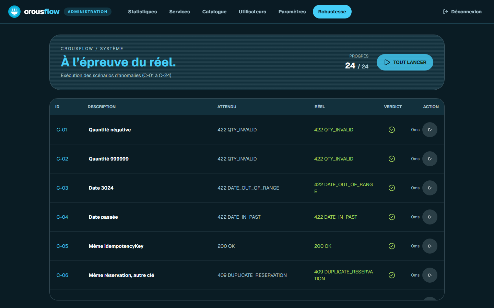
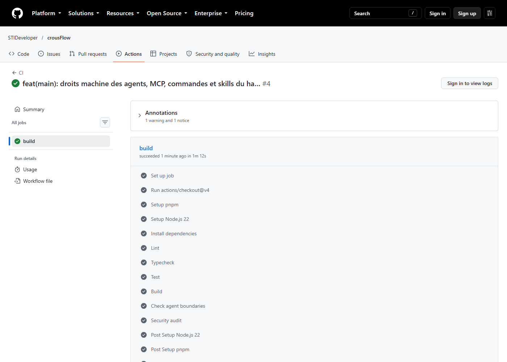
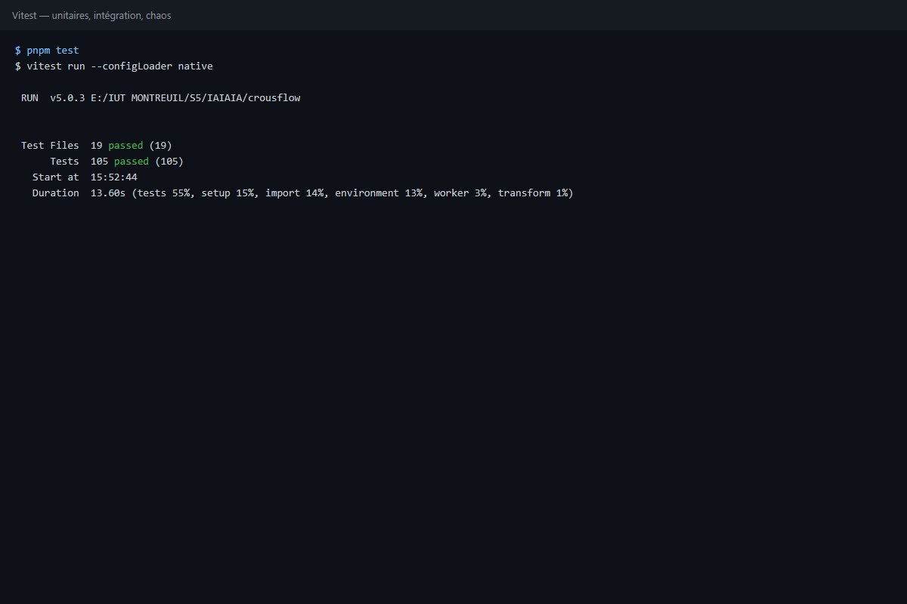
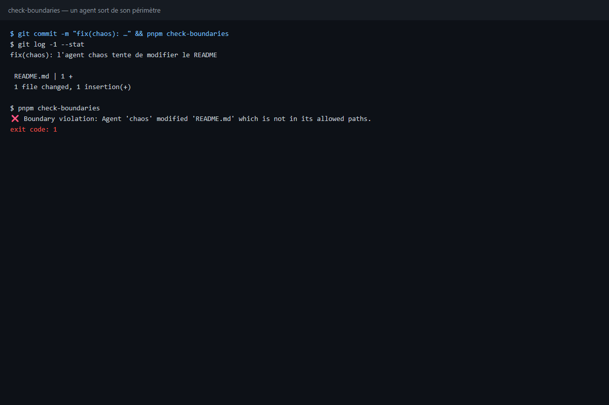

# CrousFlow

[](https://github.com/STIDeveloper/crousFlow/actions/workflows/ci.yml)

Plateforme moderne de réservation de repas pour les CROUS.

## Le Problème

Chaque midi, les files d'attente s'allongent, du gaspillage alimentaire est généré par un manque de prévisibilité, et la précarité étudiante limite l'accès aux repas.

## La Solution

CrousFlow permet la réservation à l'avance, consolide les données pour la cuisine, et utilise l'IA (Gemini) pour prévoir avec précision la demande, tout en garantissant zéro gaspillage et zéro attente.

## Stack Technique

- **Framework** : Next.js 16.4 + React 19.3
- **Base de données** : Prisma 7 + SQLite (better-sqlite3)
- **UI** : Tailwind 4.3 + shadcn/ui + motion
- **IA** : Vercel AI SDK + @ai-sdk/google (gemini-3.8-flash, configurable via `GEMINI_MODEL`)
- **QA** : Vitest + Playwright

## Installation

Prérequis : Node.js 22+ et pnpm (`corepack enable`).

```bash
pnpm install
cp .env.example .env
pnpm seed
pnpm dev
```

Ouvrir http://localhost:3000/connexion et choisir un profil de démo (connexion en un clic, sans mot de passe).

Pour une démo sur une base neuve, sans toucher `dev.db` : `pnpm build` puis `pnpm start:prod` (définir `SESSION_SECRET` et `QR_SECRET` dans l'environnement).

### IA (optionnelle)

Les quantités sont calculées par un modèle statistique (moyenne mobile pondérée sur 12 semaines). Gemini sert seulement à rédiger l'explication. Sans clé `GOOGLE_GENERATIVE_AI_API_KEY`, ou si Gemini ne répond pas sous 5 s, une explication calculée localement prend le relais. Clé gratuite : https://aistudio.google.com/apikey

## Vérifications

```bash
pnpm lint && pnpm typecheck   # ESLint + TypeScript strict
pnpm test                     # Vitest : unitaires, intégration, 24 cas chaos
pnpm test:e2e                 # Playwright : parcours étudiant, cuisine, console chaos
```

## Déploiement gratuit (Render)

Le fichier `render.yaml` décrit le service. Sur render.com : **New → Blueprint**, choisir le dépôt, puis valider. Les secrets sont générés automatiquement. La clé Gemini est optionnelle.

L'offre gratuite a un disque éphémère : la base de démo repart du seed à chaque démarrage. Le service se met aussi en veille après 15 min sans visite et met environ 1 min à se réveiller. Ouvre l'URL quelques minutes avant la démo.

## Comptes de démo

- Étudiant : `etudiant1@crousflow.test`
- Cuisine : `cuisine@crousflow.test`
- Administrateur : `admin@crousflow.test`

## Architecture

```text
CrousFlow/
├── src/
│   ├── app/           # App Router (Pages, Layouts, API Routes)
│   ├── components/    # UI (shadcn, features, layout)
│   ├── server/        # Services métiers, db, IA, sécurité
│   └── lib/           # Utils, Zod schemas
├── tests/             # Vitest (unit/integration), Playwright (e2e)
├── docs/              # ADRs, Tâches, Reviews, Pitch
└── screenshots/       # Captures d'écran de l'application
```

## Le harness (la chaîne qui a construit l'app)

| Élément | Où | Rôle |
| --- | --- | --- |
| 12 agents | `.opencode/agents/` | `main` (orchestrateur, seul à déléguer) + 11 subagents : architect, backend, data, ia, frontend, chaos, qa, ui-reviewer, security, devops, docs |
| Droits | en-tête de chaque agent + `.opencode/ownership.json` | permissions `edit` / `bash` / `task` par agent, et un propriétaire unique par chemin |
| Rules | `AGENTS.md`, `.opencode/rules/` | pipeline à portes G1 → G5, règles projet (Zod partout, jamais d'écran blanc, TDD) |
| MCP | `opencode.json` | `playwright` (navigateur, réservé à ui-reviewer), `context7` (docs à jour Next 16 / Prisma 7) |
| Commands | `.opencode/command/` | `/check`, `/chaos`, `/demo-reset`, `/new-task` |
| Skills | `.opencode/skills/` | `crous-ui-review` (revue contre DESIGN.md), `chaos-case` (ajout d'un cas de robustesse) |
| Hooks | `.husky/` | pre-commit : lint-staged, typecheck, tests, build |
| CI | `.github/workflows/ci.yml` | install → lint → typecheck → test → build → check-boundaries → audit |
| Traçabilité | `docs/tasks/`, `docs/adr/`, `docs/reviews/` | fiches de tâche par agent, décisions d'architecture, verdicts UI et sécurité |

Un commit `type(agent): …` qui touche un fichier hors du périmètre de l'agent est refusé par `pnpm check-boundaries`, en local comme en CI.

## Captures

Application : [`screenshots/`](./screenshots). Chaîne au travail : [`screenshots/chaine/`](./screenshots/chaine).

| | |
| --- | --- |
|  |  |
|  |  |
|  |  |
|  |  |

> **Note :** Ceci est une application de démonstration. Toutes les données sont générées aléatoirement (fictives). Aucune donnée personnelle réelle n'est manipulée.
